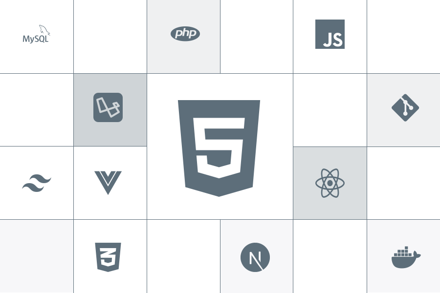

<div align="center">



# vscode-settings-json

**Моя тёмная минималистичная настройка VS Code** — `settings.json` + кастомный CSS/JS.
Тихий интерфейс, моноширинная типографика, размытая палитра команд и крупный логотип на пустом экране.


</div>

---

## ✨ Что внутри

| Файл | Назначение |
| --- | --- |
| [`settings.json`](settings.json) | Пользовательские настройки: типографика, «тишина» интерфейса, форматирование, Prettier, Tailwind и т.д. |
| [`vscode-custom/style.css`](vscode-custom/style.css) | Кастомные стили интерфейса (сайдбар, палитра команд, подсказки, логотип). |
| [`vscode-custom/script.js`](vscode-custom/script.js) | Размытие фона при открытии палитры команд (`Ctrl+P`) и скрытие sticky-виджетов. |
| [`assets/art.svg`](assets/art.svg) | Арт со стеком технологий — отображается на пустом экране редактора. |

## 🎨 Особенности

- **Типографика** — `Geist Mono` везде, комментарии в `Monaspace Radon` курсивом (`#008c7d`).
- **Сайдбар справа**, активити-бар сверху, подсветка выбранного файла `#4f5971`, заголовки `#bc9abc`.
- **Палитра команд** — градиентный фон, скруглённые углы, backdrop-blur (`script.js` добавляет затемнение/размытие).
- **Подсказки (hover)** — стеклянный градиент без рамок.
- **Пустой экран** — крупный арт вместо логотипа VS Code, без списка горячих клавиш.
- **Адаптация под 2560×1440 (100%)** — размеры шрифтов заданы в `px`, а не в `em`.
- **«Silence the Noise»** — отключены минимап, номера строк, breadcrumbs, подсветки, lightbulb и прочий шум.

## 🚀 Установка

1. Установите расширение **[Custom CSS and JS Loader](https://marketplace.visualstudio.com/items?itemName=be5invis.vscode-custom-css)** (`be5invis.vscode-custom-css`).
2. Установите шрифты: [Geist Mono](https://vercel.com/font) и [Monaspace](https://monaspace.githubnext.com/) (Radon).
3. Скопируйте папку `vscode-custom/` в `C:\Users\<you>\.vscode\`.
4. Откройте `settings.json` (`Ctrl+Shift+P` → *Preferences: Open User Settings (JSON)*) и перенесите нужные строки из [`settings.json`](settings.json).
   В `vscode_custom_css.imports` замените `YOUR_NAME` на имя своего пользователя Windows:
   ```jsonc
   "vscode_custom_css.imports": [
     "file:///C:/Users/YOUR_NAME/.vscode/vscode-custom/style.css",
     "file:///C:/Users/YOUR_NAME/.vscode/vscode-custom/script.js"
   ]
   ```
5. `Ctrl+Shift+P` → **Reload Custom CSS and JS** (запустите VS Code от администратора, если файлы приложения защищены от записи).
6. После каждого обновления VS Code команду нужно запускать заново. Сообщение «установка повреждена» — ожидаемо, его можно закрыть.

## 🖥️ Подгонка под своё разрешение

Размеры лежат в самом конце [`style.css`](vscode-custom/style.css) (блок `Scaling for 2560x1440`). Для другого экрана поменяйте числа:

```css
.monaco-workbench .part.statusbar { font-size: 13px !important; }
.letterpress { width: min(1100px, 80%) !important; }   /* размер арта на пустом экране */
```

## 🧩 Как это устроено

- CSS переопределяет внутренние классы Monaco/Workbench, поэтому после крупных обновлений VS Code селекторы могут устареть.
- Арт на пустом экране — это `.letterpress` с вшитым SVG (копия — [`assets/art.svg`](assets/art.svg)). Чтобы заменить, подставьте свой SVG в `background-image`.
- `script.js` следит за `.quick-input-widget` и добавляет/убирает слой `#command-blur`.

## ⚠️ Замечания

- Настройка меняет файлы самого VS Code — используйте на свой риск.
- Часть расширений в `settings.json` (Prettier, Tailwind CSS, Intelephense, Vetur, Material Icon Theme, CodeSnap) нужно установить отдельно.

---

<div align="center">

Сделано с ♥ — [@Nerdlin](https://github.com/Nerdlin)

</div>
